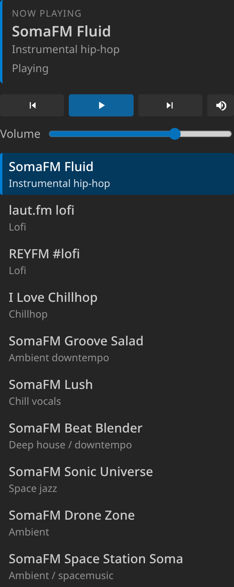

# Lofi Radio for VS Code

Chill internet radio in your VS Code sidebar and status bar. Curated lofi, chillhop, and ambient stations, plus your own, playing quietly in the background while you code.



*The sidebar player panel, rendered on the VS Code dark theme. This is a faithful mock of the actual panel markup and styles; a real screenshot captured with <kbd>F5</kbd> in the Extension Development Host can replace it.*

## Features

- Sidebar player (headphones icon in the Activity Bar) with play/pause, next/previous, and mute.
- Status bar item that shows the current station and lets you toggle playback with the sidebar closed.
- Command Palette commands for every control.
- A play/pause keyboard shortcut: <kbd>Ctrl</kbd>+<kbd>Alt</kbd>+<kbd>L</kbd> (<kbd>Cmd</kbd>+<kbd>Alt</kbd>+<kbd>L</kbd> on macOS).
- Remembers your last station and volume across sessions.
- Add your own stations through settings, merged with the built-in list.
- Automatic reconnect with exponential backoff when a stream drops, then a clear "station offline" notice. It never auto-switches stations.
- Optional "resume on startup" that opens the player ready to play.

## Usage

There are three ways to drive the player:

1. **Sidebar** — click the headphones icon in the Activity Bar to open the **Lofi Radio** view, then use the play/pause, previous, next, and mute controls.
2. **Status bar** — the status bar item shows the current station and status; click it to toggle play/pause. It keeps working even when the sidebar is closed.
3. **Command Palette** — run any of the `Lofi Radio:` commands:
   - `Lofi Radio: Play / Pause`
   - `Lofi Radio: Next Station`
   - `Lofi Radio: Previous Station`
   - `Lofi Radio: Pick Station…` (Quick Pick list of all stations)
   - `Lofi Radio: Toggle Mute`

### One click to start audio (needsClick)

VS Code webviews enforce the browser autoplay policy: audio cannot start until you have interacted with the player once. The first time you try to play, the player enters a **needsClick** state (the status bar shows a hand icon) and waits for a single click inside the sidebar player. After that one gesture, playback starts and every control — including the status bar item and the keybinding — works normally for the rest of the session.

### Keyboard shortcut

Toggle play/pause with <kbd>Ctrl</kbd>+<kbd>Alt</kbd>+<kbd>L</kbd> (<kbd>Cmd</kbd>+<kbd>Alt</kbd>+<kbd>L</kbd> on macOS). You can rebind it in **Keyboard Shortcuts** by searching for `lofi.togglePlay`.

### Mute

Use the mute button in the sidebar or `Lofi Radio: Toggle Mute`. Mute is separate from stopping playback: the stream keeps running, it is just silenced. Your volume is remembered across sessions.

## Settings

### `lofiRadio.customStations`

Extra stations, merged after the built-in list. Each entry needs `id`, `name`, and `streamUrl` (an http(s) URL); `genre` and `homepage` are optional. Invalid entries are skipped with a warning, and a custom `id` that collides with a built-in one is automatically renamed.

Copy-paste this into your `settings.json` and edit to taste:

```json
"lofiRadio.customStations": [
  {
    "id": "my-lofi",
    "name": "My Lofi",
    "streamUrl": "https://example.com/stream.mp3",
    "genre": "Lofi",
    "homepage": "https://example.com"
  }
]
```

### `lofiRadio.resumeOnStartup`

Boolean, off by default. When on, VS Code opens the Lofi Radio player with your last station ready as soon as the window finishes starting. It **cannot auto-start audio**: the browser autoplay policy still applies, so the player only reveals itself ready to play — press the play button (or <kbd>Ctrl</kbd>+<kbd>Alt</kbd>+<kbd>L</kbd> / <kbd>Cmd</kbd>+<kbd>Alt</kbd>+<kbd>L</kbd>) once to begin.

## Built-in stations

| Station | Genre | Source / attribution |
|---|---|---|
| SomaFM Fluid | Instrumental hip-hop | [SomaFM](https://somafm.com/fluid/) — listener-supported; please [support them](https://somafm.com/support/) |
| laut.fm lofi | Lofi | [laut.fm](https://laut.fm/lofi) |
| REYFM #lofi | Lofi | [REYFM](https://www.reyfm.de/) |
| I Love Chillhop | Chillhop | [I Love Music](https://www.ilovemusic.de/ilovechillhop/) |
| SomaFM Groove Salad | Ambient downtempo | [SomaFM](https://somafm.com/groovesalad/) — listener-supported; please [support them](https://somafm.com/support/) |
| SomaFM Lush | Chill vocals | [SomaFM](https://somafm.com/lush/) — listener-supported; please [support them](https://somafm.com/support/) |
| SomaFM Beat Blender | Deep house / downtempo | [SomaFM](https://somafm.com/beatblender/) — listener-supported; please [support them](https://somafm.com/support/) |
| SomaFM Sonic Universe | Space jazz | [SomaFM](https://somafm.com/sonicuniverse/) — listener-supported; please [support them](https://somafm.com/support/) |
| SomaFM Drone Zone | Ambient | [SomaFM](https://somafm.com/dronezone/) — listener-supported; please [support them](https://somafm.com/support/) |
| SomaFM Space Station Soma | Ambient / spacemusic | [SomaFM](https://somafm.com/spacestation/) — listener-supported; please [support them](https://somafm.com/support/) |

Streams belong to their operators. Station operators who want their stream removed can [open an issue](https://github.com/deepu0/vscode-lofi/issues).

## Web / vscode.dev support

Lofi Radio ships a **web extension bundle** in addition to the desktop one, so it can run in the browser-based editors ([vscode.dev](https://vscode.dev) and github.dev). The extension code uses only the `vscode` API and the webview `<audio>` element (no Node-only APIs), so the web target is just a second esbuild bundle (`platform: "browser"` → `dist/web/extension.js`, referenced by the `browser` field in `package.json`) with no source changes. See [docs/decisions.md](docs/decisions.md) (Q16). Web-host playback depends on the browser and on whether a given stream allows cross-origin playback; the desktop host remains the primary, fully tested target.

## Development

```sh
npm install
npm run build       # bundles desktop + web + experiment via esbuild
npm run typecheck   # tsc --noEmit
```

Press <kbd>F5</kbd> in VS Code to launch the extension in a development host.

The Marketplace icon (`media/icon.png`, 128×128) is generated from the activity-bar motif with `npm run icon`.

### Playback experiment

`npm run experiment` launches a real VS Code instance via `@vscode/test-electron` and drives the extension to verify that every station reaches a playing state, that audio keeps advancing while the sidebar is hidden, and that the status bar toggle works after one click. It needs a display; on a headless Linux box run `Xvfb :99 -screen 0 1280x800x24 &` and `export DISPLAY=:99` first. Results are written to `experiment-results.json`.

### Packaging a .vsix

```sh
npm run package     # runs `vsce package`
```

This produces a `.vsix` you can install with **Extensions: Install from VSIX…** or publish to the Marketplace. `@vscode/vsce` is included as a dev dependency.

## License

MIT
